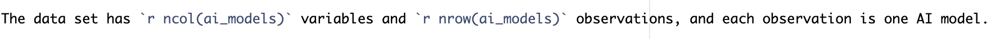

## Loading libraries

```{r setup, include=FALSE}
library(dplyr)
library(ggplot2)
library(knitr)

# Section 1 stays hidden. Later chunks show their code.
knitr::opts_chunk$set(echo = TRUE)
```

## Research question

Do notable AI models with more parameters also require more training compute, and has this relationship changed across the three eras of AI development?

## Data set introduction

```{r prepare-data}
compute_raw <- read.csv(
  "Data/raw/training-computation-vs-dataset-size-in-notable-ai-systems.csv",
  check.names = FALSE
)
parameters_raw <- read.csv(
  "Data/raw/parameters-in-notable-artificial-intelligence-systems.csv",
  check.names = FALSE
)

ai_joined <- inner_join(compute_raw, parameters_raw, by = c("Entity", "Day"))

ai_models <- ai_joined |>
  mutate(
    year = as.numeric(substr(Day, 1, 4)),
    era = case_when(
      year < 2010 ~ "Pre-deep learning",
      year <= 2015 ~ "Deep learning",
      TRUE ~ "Large-scale"
    ),
    era = factor(era, levels = c("Pre-deep learning", "Deep learning", "Large-scale"))
  ) |>
  select(
    parameters = `Number of parameters`,
    training_compute = `Training computation (petaFLOP)`,
    dataset_size = `Training dataset size`,
    year,
    era
  ) |>
  filter(!is.na(parameters), !is.na(training_compute), !is.na(dataset_size))

c(
  compute_file = nrow(compute_raw),
  parameters_file = nrow(parameters_raw),
  joined = nrow(ai_joined),
  complete = nrow(ai_models)
)

write.csv(ai_models, "Data/merged.csv", row.names = FALSE)
```

The data covers notable AI models and comes from two Our World in Data files by Epoch AI (2026), with major processing by Our World in Data: [training compute and dataset size](https://ourworldindata.org/grapher/training-computation-vs-dataset-size-in-notable-ai-systems) and [number of parameters](https://ourworldindata.org/grapher/parameters-in-notable-artificial-intelligence-systems). The code above joins the two files by model name and date and keeps only models with no missing values, so each row is one model.

`parameters` is the number of weights in a model, and `training_compute` is the compute used to train it, in petaFLOP (one petaFLOP is $10^{15}$ calculations). `dataset_size` is the amount of training data, and its unit (images, words or game steps) depends on the type of model. `year` is the year the model was published, and `era` groups each model into one of three periods from Sevilla et al. (2022): pre-deep learning (before 2010), deep learning (2010–2015) and large-scale (2016 onwards).

```{r variable-table}
variable_types <- data.frame(
  variable = names(ai_models),
  type = sapply(ai_models, class),
  row.names = NULL
)

kable(variable_types, caption = "Variables in the analysis table")
```

## Data set description

The data set has `r ncol(ai_models)` variables and `r nrow(ai_models)` observations, and each observation is one AI model.

```{r inline-code-image, out.width = "80%"}

```

```{r data-structure}
str(head(ai_models, 2))
```

## Data summary

```{r era-summary}
era_summary <- ai_models |>
  select(era, parameters, training_compute) |>
  group_by(era) |>
  summarise(
    median_parameters = median(parameters),
    mean_parameters = mean(parameters),
    median_compute = median(training_compute),
    mean_compute = mean(training_compute)
  ) |>
  head(10)

kable(
  era_summary,
  caption = "Median and mean parameters and training compute (petaFLOP) by era",
  format.args = list(digits = 3)
)
```

Median parameters and median training compute both **rise** in each era, from about 18,600 parameters and 0.0002 petaFLOP before 2010 to about 1.8 billion parameters and 9 million petaFLOP from 2016. Each mean is far above its median because a few very large models pull it up, so the median better describes a typical model.

## Visualisation

```{r parameters-compute-plot, fig.cap = "Parameters and training compute of notable AI models, coloured by era (both axes on a log scale)"}
ggplot(ai_models, aes(x = parameters, y = training_compute, colour = era)) +
  geom_point(alpha = 0.7) +
  scale_x_log10() +
  scale_y_log10() +
  labs(
    x = "Number of parameters (log scale)",
    y = "Training compute (petaFLOP, log scale)",
    colour = "Era"
  ) +
  theme_minimal()
```

- *Models with more parameters used more training compute, so the points form a clear upward band in all three eras.*
- *Large-scale models with the same number of parameters, they often used more compute than older models.*

### Training compute over time

The figure below shows training compute by year, to check how fast compute grew in each era. Before 2010 the points rise slowly, but from 2010 they climb much more steeply, and most large-scale models from 2016 sit above all earlier models. This matches Sevilla et al. (2022), who found that training compute doubled about every 20 months before 2010 and about every 6 months after.

```{r compute-year-plot, fig.cap = "Training compute of notable AI models by year, coloured by era (log scale)"}
ggplot(ai_models, aes(x = year, y = training_compute, colour = era)) +
  geom_point(alpha = 0.7) +
  scale_y_log10() +
  labs(
    x = "Year of publication",
    y = "Training compute (petaFLOP, log scale)",
    colour = "Era"
  ) +
  theme_minimal()
```

### Large models with little compute

The table below checks whether some models had many parameters but needed fewer compute. Within each era, a model is large if its parameters are above the era median, and it used little compute if its compute is below the era median. Most large models also used a lot of compute, which supports the main answer. However, in every era some large models used little compute: 19% before 2010, 25% in 2010–2015 and 12% from 2016. One possible reason may be sparse designs such as mixture-of-experts models, which add parameters while each input uses only a small part of them (Fedus et al., 2022). Median dataset size is shown for context only, because its unit differs by type of model.

```{r large-low-compute-table}
large_low_compute <- ai_models |>
  group_by(era) |>
  mutate(
    large = parameters > median(parameters),
    low_compute = training_compute < median(training_compute)
  ) |>
  summarise(
    models = n(),
    large_models = sum(large),
    large_low_compute = sum(large & low_compute),
    share_percent = round(100 * large_low_compute / large_models),
    median_dataset_size = median(dataset_size)
  )

kable(
  large_low_compute,
  caption = "Large models (above-median parameters) that used below-median training compute, by era",
  format.args = list(digits = 3)
)
```

## Conclusions

The data from Epoch AI (2026) shows that notable AI models with more parameters also needed more training compute. In the summary table, median parameters and median compute rise together in each of the three eras from Sevilla et al. (2022), and the figure shows a clear upward band in all of them. The link has also changed over time. Large-scale models from 2016 often used much more compute than older models with the same number of parameters, so each parameter now takes more compute to train. One limitation is that dataset size is not on one scale, because vision models count images, but language models count words, and the data source has no domain column.

## References

Epoch AI (2026) – with major processing by Our World in Data. "Parameter, Compute and Data Trends in Machine Learning." Retrieved 24 October 2026 from Our World in Data, <https://ourworldindata.org/grapher/training-computation-vs-dataset-size-in-notable-ai-systems> and <https://ourworldindata.org/grapher/parameters-in-notable-artificial-intelligence-systems>.

Sevilla, J., Heim, L., Ho, A., Besiroglu, T., Hobbhahn, M., and Villalobos, P. (2022). Compute Trends Across Three Eras of Machine Learning. arXiv:2202.05924. <https://arxiv.org/abs/2202.05924>

Fedus, W., Zoph, B., and Shazeer, N. (2022). Switch Transformers: Scaling to Trillion Parameter Models with Simple and Efficient Sparsity. *Journal of Machine Learning Research*, 23(120), 1–39. <https://jmlr.org/papers/v23/21-0998.html>
